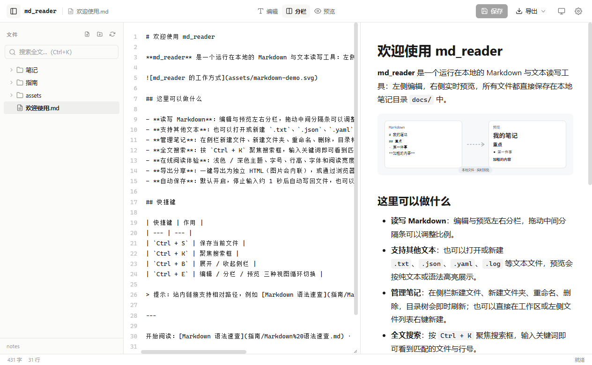
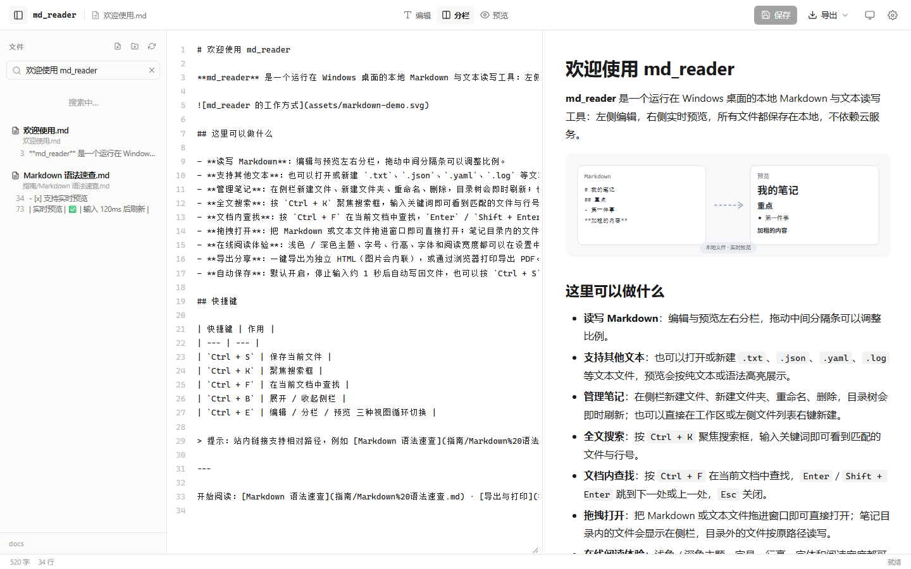
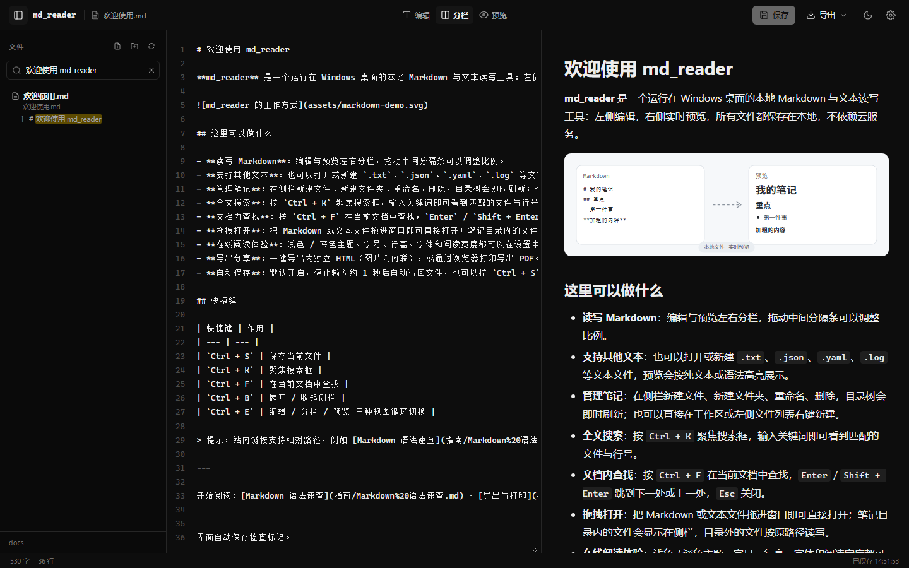
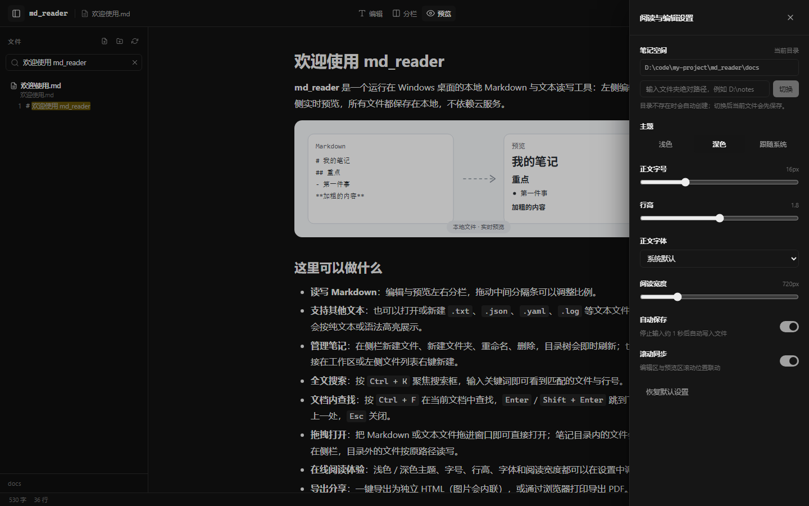
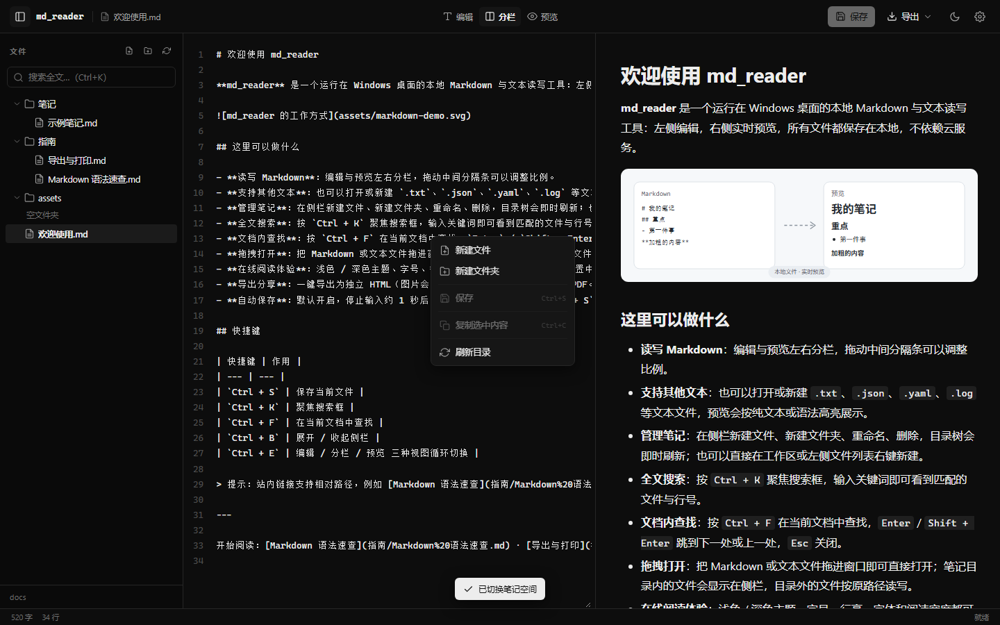
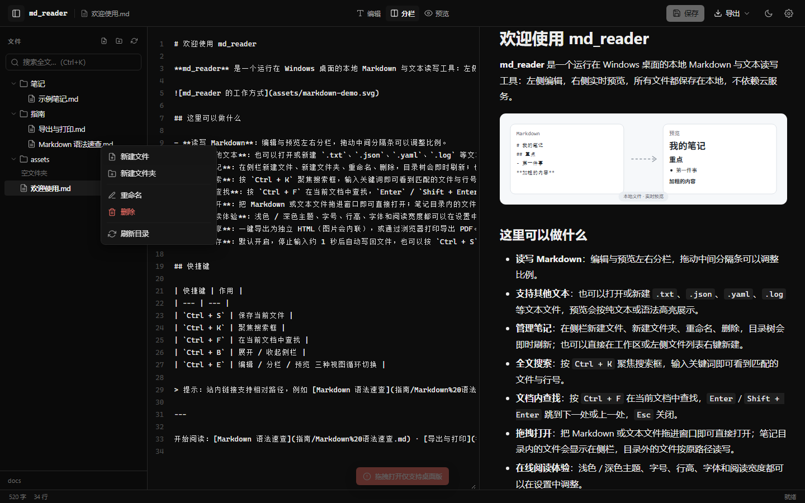
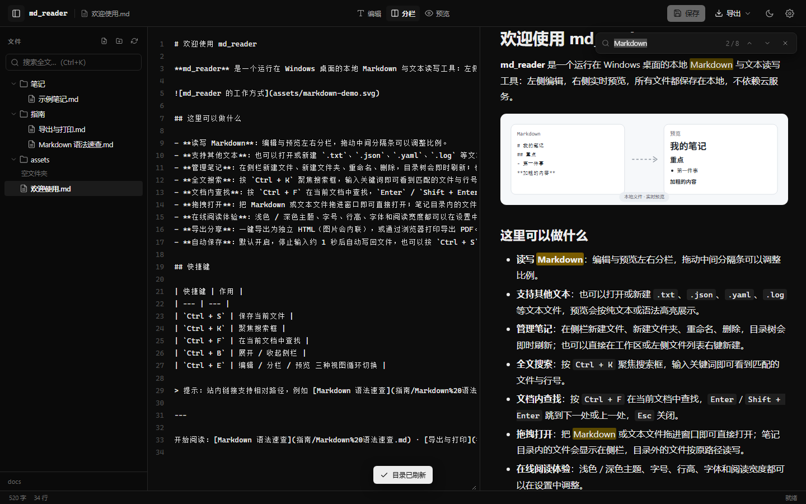
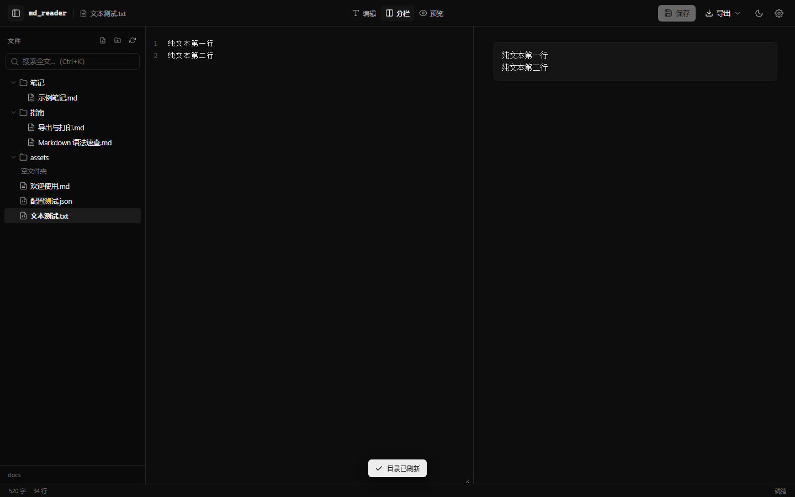

# md_reader

一个轻量的 Windows 本地 Markdown / 文本编辑器与阅读器。

左侧编辑、右侧实时预览，文件直接保存在本地，不依赖云服务，也不需要账号。

Windows 10/11 · Electron · React · TypeScript



## 功能

- **编辑 + 实时预览**：左右分栏，拖动中间分隔条调整比例，可切换「编辑 / 分栏 / 预览」三种视图。
- **多种文本格式**：除了 Markdown，也支持 `txt / log / json / yaml / toml / csv / xml / html / css / js / ts / py / go / sql` 等常见文本文件；Markdown 渲染为富文本，代码类文件带语法高亮，其余按纯文本展示。
- **本地文件管理**：侧栏展示目录树，支持新建文件、新建文件夹、重命名、递归删除，目录即时刷新。
- **右键快捷菜单**：左侧文件列表右键可新建文件 / 文件夹，针对具体文件或文件夹还能重命名、删除；工作区右键可新建、保存、复制选中内容或刷新目录。
- **笔记空间可切换**：在设置面板查看当前目录、输入绝对路径即可切换；目录不存在会自动创建，切换前会先保存当前文件，并记住最近使用的目录。
- **全文搜索**：按 `Ctrl + K` 搜索所有文本文件，展示命中文件、行号和高亮片段，点击即可打开。
- **文档内查找**：按 `Ctrl + F` 在当前文档中查找，显示命中数量，`Enter` / `Shift + Enter` 前后跳转，`Esc` 关闭；编辑与预览会同步定位。
- **拖拽打开**：把 Markdown 或文本文件直接拖进窗口即可打开；笔记目录内的文件会显示在侧栏，目录外的文件按原路径读写。
- **阅读体验**：浅色 / 深色 / 跟随系统主题，可调字号、行高、字体和阅读宽度；代码块语法高亮、任务列表、表格、站内链接与图片。
- **保存**：默认开启自动保存（停止输入约 1 秒写回），也可按 `Ctrl + S` 手动保存；状态栏显示保存状态、字数与行数。
- **导出**：导出为自包含 HTML（本地图片自动内联），或通过应用内打印导出 PDF。
- **便携桌面版**：Electron 内置本地服务与界面，可打包为可整体复制的 Windows 应用。

## 界面

| 浅色 | 深色 |
| --- | --- |
|  |  |











## 快速开始

要求 Windows 与 Node.js 20.19+（本项目在 Node 24 上验证）。

```powershell
git clone https://github.com/mlbdzj/markdown_reader.git
cd markdown_reader
npm install
```

如果 `npm install` 因安全策略跳过了 Electron 的安装脚本，先执行 `node node_modules/electron/install.js` 补装运行时。

### 开发运行

```powershell
# 构建前端并启动桌面版
npm run dev

# 或分步执行
npm run build
npm run desktop
```

### 打包便携版

```powershell
npm run package:desktop

# 输出
release/md_reader-win32-x64/md_reader.exe
```

仓库不包含 `release/` 打包产物，需要本地生成。双击 `md_reader.exe` 即可运行，`md_reader-core.exe` 是实际运行时，请保留在同一目录。

启动器会优先正常启动；如果系统环境导致 Chromium 无法初始化，会自动使用兼容参数重启（关闭 Chromium 沙箱）。

打包需要 Windows 自带的 .NET Framework C# 编译器（`csc.exe`）来生成启动器。

## 数据与隐私

- 笔记默认保存在 `文档\md_reader`，首次启动会复制示例文档。
- 若系统保护「文档」目录导致不可写，会自动改用应用目录下的 `profile\notes`。
- 设置、最近目录和启动日志位于应用目录的 `profile` 文件夹，移动整个应用文件夹即可迁移。
- 拖入笔记目录外的文件不会复制，编辑后直接写回原文件。
- 所有文件都留在本机；没有账号、云同步和遥测。

## 快捷键

| 快捷键 | 作用 |
| --- | --- |
| `Ctrl + S` | 保存当前文件 |
| `Ctrl + K` | 聚焦搜索框 |
| `Ctrl + F` | 在当前文档中查找 |
| `Ctrl + B` | 展开 / 收起侧栏 |
| `Ctrl + E` | 编辑 / 分栏 / 预览循环切换 |

## 技术栈

| 层 | 使用 |
| --- | --- |
| 桌面容器 | Electron 45 + 便携式 C# 启动器 |
| 前端 | React 19、TypeScript 5、Vite 7 |
| Markdown | markdown-it、DOMPurify、highlight.js |
| 本地服务 | Node.js 原生 `http`，随 Electron 启动，仅监听 `127.0.0.1` |
| 打包 | @electron/packager |

## 目录结构

```text
md_reader/
├─ server/              桌面版内置本地服务（随 Electron 启动，不单独提供浏览器入口）
│  ├─ index.mjs         HTTP 路由、静态资源、API
│  ├─ store.mjs         文件树、读写、搜索、路径校验
│  └─ config.mjs        端口、笔记根目录等配置
├─ desktop/             Electron 主进程与 preload（内置服务、窗口、拖入文件路径）
├─ launcher/            Windows 启动器源码（正常启动失败时自动兼容启动）
├─ src/                 React + TypeScript 前端
│  ├─ App.tsx           应用状态与业务流程
│  ├─ components/       工具栏、侧栏、编辑器、预览、设置等
│  ├─ lib/              Markdown 渲染、导出、设置、工具函数
│  └─ styles/           应用样式与 Markdown 正文样式
├─ docs/                内置示例文档（首次启动复制到笔记目录）
├─ build/               应用图标
├─ screenshots/         界面截图
├─ scripts/             接口测试、界面检查、桌面打包
├─ public/              favicon 等静态资源
└─ release/             桌面打包产物（已加入 .gitignore）
```

## 开发检查

```powershell
# 接口集成测试（会自动启动临时服务并使用临时目录）
npm run test:api

# 界面冒烟检查（开发用，需要 Chrome 远程调试端口 9222）
npm run test:ui
```

`test:ui` 会自动启动内部服务，检查渲染、搜索、文件操作、文档内查找、拖拽提示、主题、视图与导出，并生成截图到 `.shots/`。运行前先启动无头 Chrome：

```powershell
& "C:\Program Files\Google\Chrome\Application\chrome.exe" `
  --headless=new --no-sandbox --disable-gpu `
  --remote-debugging-port=9222 `
  --user-data-dir="$PWD\.chrome-profile" `
  --window-size=1440,900 about:blank
```

## 已知限制

- 不监听外部文件变化：在应用外修改文件后，点击侧栏的「刷新目录」即可同步。
- 只有 `.md` / `.markdown` 会进行 Markdown 渲染；其他文本格式按纯文本或语法高亮预览。
- 编辑区是纯文本编辑框，没有行内语法高亮；代码高亮只出现在预览和导出的 HTML 中。
- 仅支持文本文件，不支持编辑二进制、图片或 Office 文档；图片只在 Markdown 预览中显示。
- 切换笔记空间只改变读写目录，不会移动或复制文件；当前编辑内容会先保存到原目录。
- 重命名目录后，目录的展开状态会重置；编辑器内未保存的内容不受影响。
- 拖入笔记目录外的文件会直接读写原路径，不会加入侧栏；标题栏悬停可查看完整路径。
- PDF 依赖系统打印对话框中的「另存为 PDF」，不同系统的页边距选项略有差异。
- 搜索为不区分大小写的子串匹配，不索引附件或图片。
- 导出 HTML 时单张本地图片上限为 8MB，超出时保留原相对路径。
- 没有账号、权限和多用户能力；笔记空间可以切换到本机任意可写目录，仅建议在本机使用。
- 桌面版是便携目录，不包含安装器、自动更新和代码签名；在部分受保护的系统环境中，启动器会自动切换到关闭 Chromium 沙箱的兼容模式。
- 便携版需要放在可写目录（如桌面、用户目录），否则无法创建 `profile` 和笔记目录。

## 反馈

问题或建议请提交到 [GitHub Issues](https://github.com/mlbdzj/markdown_reader/issues)。

如果这个项目对你有帮助，欢迎点一个 Star。
