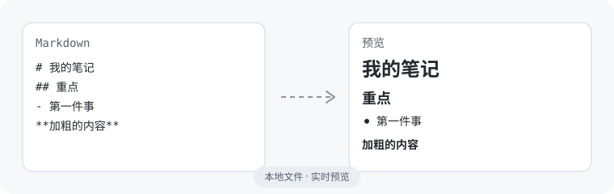

# Markdown 语法速查

这里覆盖日常写作最常用的语法，修改左侧内容即可看到右侧的实时效果。

## 标题与段落

使用 `#` 创建标题，最多支持六级。段落之间用空行分隔。

## 强调

- **加粗**：`**加粗**`
- *斜体*：`*斜体*`
- ~~删除线~~：`~~删除线~~`
- `行内代码`：`` `行内代码` ``
- [链接](https://commonmark.org)：`[链接](https://commonmark.org)`

## 列表

无序列表：

- 第一项
- 第二项
  - 嵌套项
- 第三项

有序列表：

1. 准备素材
2. 撰写正文
3. 校对发布

任务清单：

- [x] 支持实时预览
- [x] 支持全文搜索
- [ ] 增加更多导出模板

## 引用

> 好的文档不是写出来的，而是改出来的。
>
> —— 某位编辑

## 代码

行内代码：`md_reader.exe`。

带语言高亮的代码块：

```ts
interface Note {
  title: string;
  tags: string[];
}

export function format(note: Note): string {
  return `${note.title} · ${note.tags.join(', ')}`;
}
```

```bash
# 开发运行（构建前端并启动桌面版）
npm run dev

# 打包 Windows 便携版
npm run package:desktop
```

## 表格

| 功能 | 状态 | 说明 |
| --- | :---: | --- |
| 实时预览 | ✅ | 输入 120ms 后刷新 |
| 自动保存 | ✅ | 停止输入约 1 秒 |
| 导出 HTML | ✅ | 图片自动内联 |
| 导出 PDF | ✅ | 调用系统打印 |

## 分割线与图片

---

本地图片会通过应用内接口读取并显示，例如：



## 纯文本兜底

如果某些扩展语法不被支持，Markdown 会将其按普通文本展示，不会破坏排版。例如下面这段没有语言标注的代码：

```
plain text
  indented line
```

---

返回 [欢迎使用](../欢迎使用.md)。
